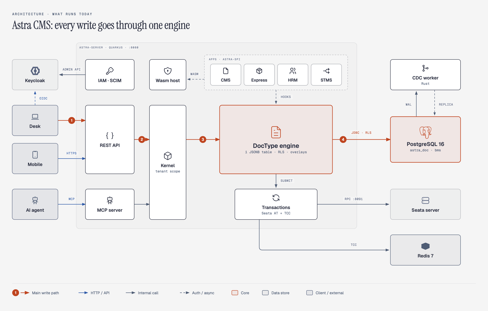

# Astra CMS

> Part of [OpenWork](../../README.md).

A **metadata-driven, plugin-first application platform** for businesses that change constantly and cannot afford
downtime. Inspired by the ideas of Frappe and ERPNext, rebuilt from scratch on Java 25 and Quarkus. It shares no
code, schema or assets with either.

A DocType defines schema, form, REST API, permissions, workflow and compliance metadata as data. Apps plug in
through three isolation tiers: shared, isolated JVM, or WebAssembly. Every DocType is also a tool for AI agents
through a built-in MCP server.

**Use it as a base for:** multi-tenant back-office and ERP work. The code shows tenancy through `ScopedValue` plus
PostgreSQL row-level security, a zero-DDL JSONB document store, a submit/cancel/amend lifecycle, an append-only
ledger, per-tenant overlays, a Wasm plugin sandbox, Seata distributed transactions, and Keycloak sign-in with
SAML and SCIM.

<a href="docs/architecture/astra-architecture.en.html">
  
</a>

## Status

Runs today: the Maven multi-module build, tenant isolation, the DocType store with generated REST, the document
lifecycle, the ledger, overlays, the Wasm sandbox, the MCP server, the Rust CDC worker, Seata AT and TCC, Keycloak
sign-in, a metadata-driven Desk UI, and a k3d deployment with two kernel pods.

Not built yet: row-level permission conditions, signed release artifacts, audit hash chain, field encryption, and a
full Desk with dashboards and reports. Parts of the longer design documents describe the target, not shipped code.

## Modules

| Module | Role |
|---|---|
| `astra-spi` | Public extension interfaces (tenant context, hooks, ledger, MCP tools) |
| `astra-kernel` | Tenant resolution, rules, rollout of plugin versions |
| `astra-doctype` | DocType registry, JSONB document store, series, projections |
| `astra-iam` | Keycloak integration, roles, SCIM |
| `astra-plugin-host` | Tier 1 isolated-JVM and Tier 2 WebAssembly (Chicory) hosts |
| `astra-tx-seata` | Seata AT/TCC transactions |
| `astra-ai` | MCP server |
| `astra-cdc-rust` | Rust CDC worker (`pgoutput` to replica tables) |
| `astra-server` | The Quarkus application and the Desk UI |
| `astra-apps/*` | Example apps: `cms`, `express` (courier), `hrm`, `stms` (vehicle routing) |
| `tenants/`, `deploy/` | Demo tenants, Docker Compose, Keycloak realm, k3d manifests |

## Run it

Requires JDK 25 and Docker. The Maven wrapper is included.

```bash
./mvnw -pl astra-server -am test     # starts a throwaway PostgreSQL and proves tenant isolation
make infra-up && make dev            # PostgreSQL, Redis, Keycloak, then Quarkus dev mode
make demo                            # two tenants, hooks, naming series, row-level security
make demo-seed                       # seed the Astra Express courier demo through the REST API
open http://localhost:8080/desk/     # generated Desk UI
```

Kubernetes (k3d) with two kernel pods, Seata, the CDC worker and ingress: `make k3d-up`, `make demo-express`,
`make k3d-down`. The scene-by-scene demos need Bash 5.

## Read next

- [Why each design choice](docs/explain.en.md)
- [Use case: a courier company on Astra](docs/use-case-01.md)
- [DocType JSONB benchmark](docs/benchmark-doctype-jsonb-the-right-way.md)
- [Mobile and IAM integration](docs/iam-mobile-integration.md)
- [Pricing rules and Wasm overlays](docs/pricing-rules.md), [overlays](docs/overlay-wasm.md)

## Clean-room rule

Do not copy code, schema, fixtures or UI assets from ERPNext (GPL-3.0) or any GPL project. Referring to Frappe
concepts such as "DocType" as shared vocabulary is fine; every implementation here is original.

## Contributing

Issues and pull requests are welcome. Read the [contributing guide](../../CONTRIBUTING.md) first; the checks
for this project are `make build && make test`.

## License

[MIT](LICENSE)
